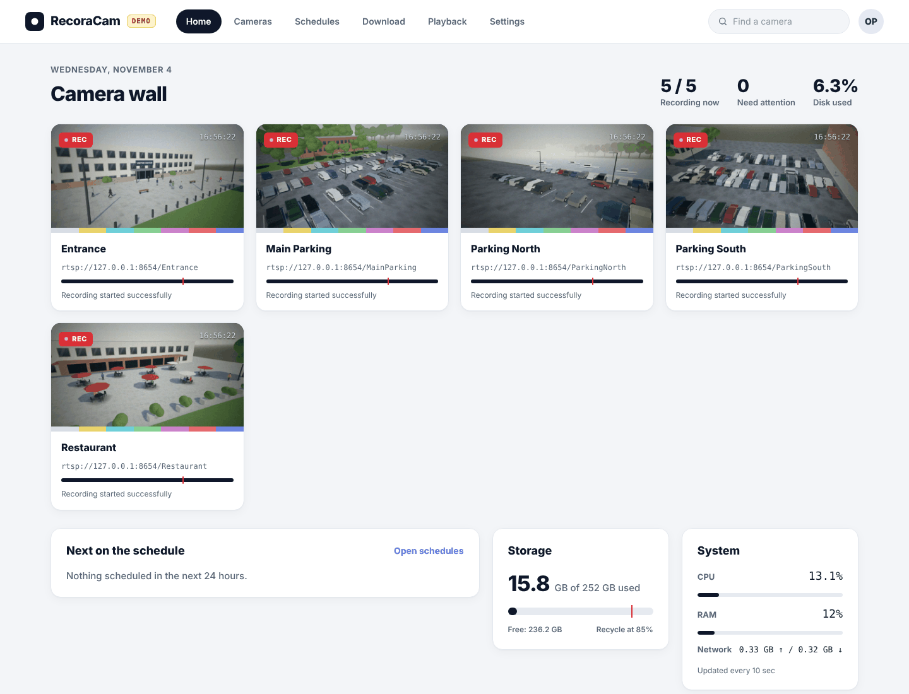
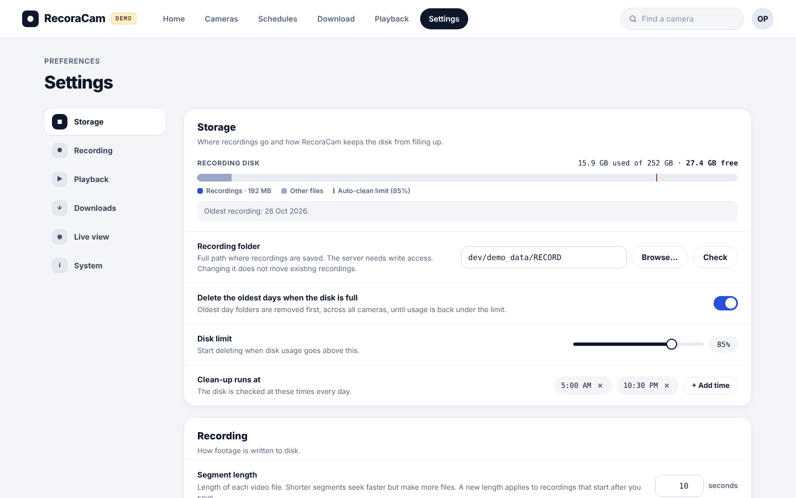
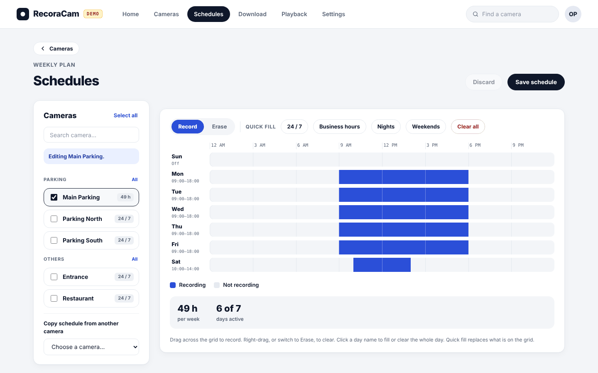
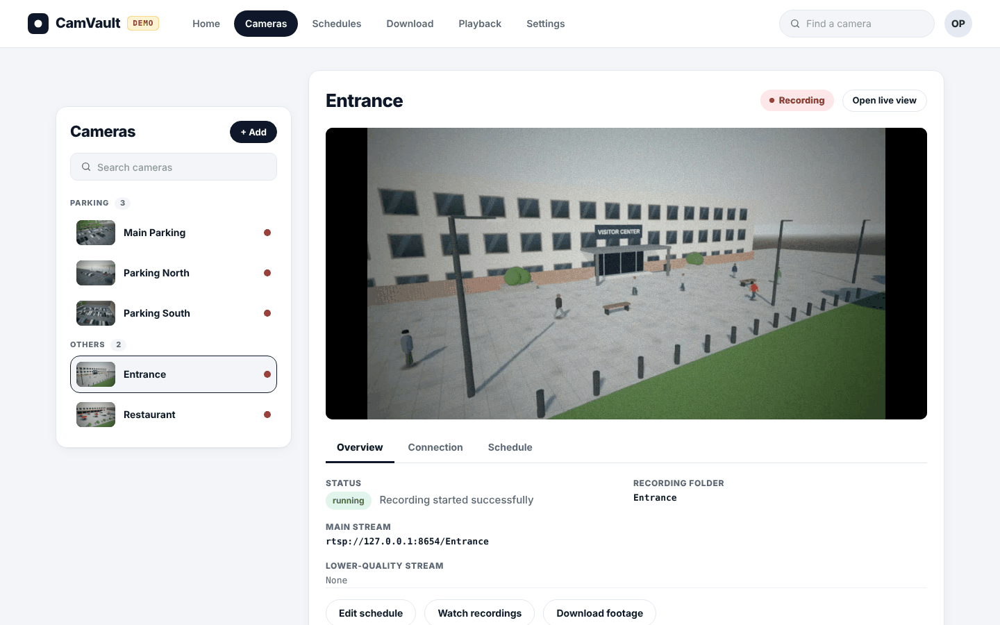
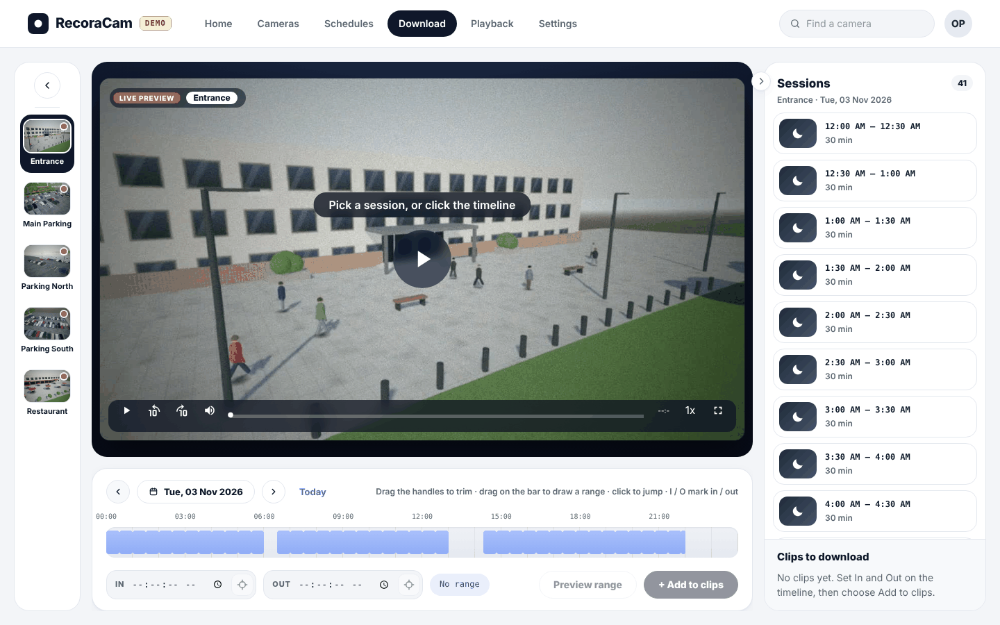
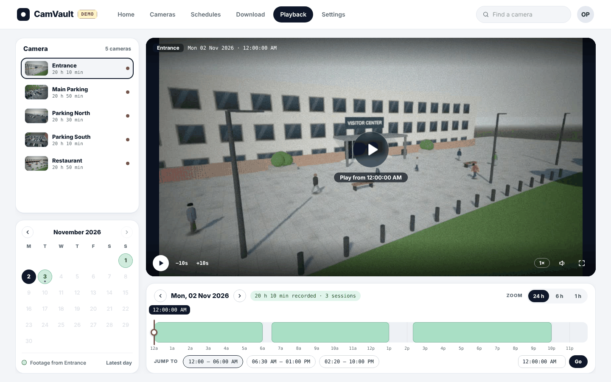
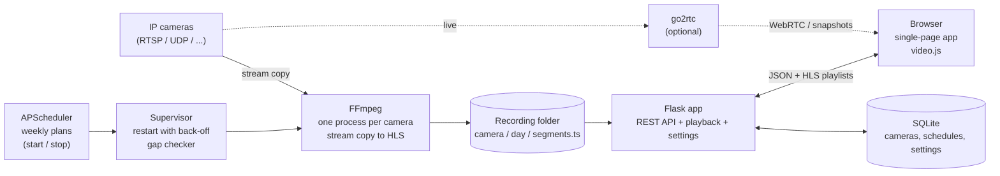

<div align="center">

# RecoraCam NVR

**A self-hosted, schedule-first network video recorder for IP cameras.**
Plan recordings on a weekly grid, play back any moment on a 24-hour timeline and download the exact clip as MP4 — from any browser, with no cloud and no subscription.

**[Project website](https://haris-pp.github.io/recoracam-website/)**




</div>

---

## Contents

- [Features](#features)
- [Screenshots](#screenshots)
- [Quick start](#quick-start)
- [Adding your cameras](#adding-your-cameras)
- [Optional components: live view and demo mode](#optional-components-live-view-and-demo-mode)
- [How it works](#how-it-works)
- [Tools and technologies](#tools-and-technologies)
- [Configuration](#configuration)
- [Storage planning](#storage-planning)
- [Security and privacy](#security-and-privacy)
- [Project structure](#project-structure)
- [Utilities](#utilities)
- [Troubleshooting](#troubleshooting)
- [Roadmap](#roadmap)
- [Contributing](#contributing) · [License](#license) · [Third-party software](#third-party-software)

## Features

**The three things RecoraCam is built around:**

1. **Schedule** — plan the week on a 15-minute grid, per camera or for several at once. Each camera records only when you want it to.
2. **Play back** — pick a day on the calendar and scrub a 24-hour timeline; zoom in, jump between sessions, play across gaps.
3. **Download clips** — mark an in and an out point, queue several clips and save them as MP4 files.

Everything else (adding cameras, live view, disk clean-up, the supervisor that restarts a failed recorder) exists to keep those three working.

| Area | What you get |
|------|--------------|
| **Schedules** | Weekly planner on a 15-minute grid, per camera or for several cameras at once, with quick fills (24/7, business hours, nights, weekends) and *copy from another camera*. |
| **Playback** | Pick a camera and day on a calendar, scrub a 24-hour timeline (zoom 24 h / 6 h / 1 h), jump between recorded sessions, play across gaps and into the next day. Keyboard shortcuts, speed control, 12/24-hour clock. |
| **Download** | Mark an *in* and *out* point on the timeline, queue several clips and download them as MP4 files. H.264 cameras are copied losslessly in seconds; other codecs (e.g. MPEG-2) are converted on the GPU if NVIDIA is present, otherwise on the CPU. |
| **Cameras** | Add any stream FFmpeg can read (`rtsp://`, `rtsps://`, `rtmp://`, `http(s)://`, `udp://`, `rtp://`, `srt://`, `tcp://`). A **Test connection** button reports codec, resolution and frame rate before you save. Optional lower-resolution *substream* per camera. |
| **Recording** | FFmpeg **stream copy** (`-c copy`): no re-encoding, so CPU use stays close to zero and quality is exactly what the camera sends. Footage is cut into short segments (1–300 s, default 10 s) and stored as `camera / day / segment` — plain files you can open with any player. |
| **Reliability** | A supervisor restarts a failed recorder with exponential back-off, and a gap checker (every 60 s) restarts any camera that *should* be recording but is not — covering app restarts, network drops and silent FFmpeg deaths. |
| **Live view** | Camera wall with snapshots; click a tile for live video (WebRTC through go2rtc, with fallback). Lower-resolution substream for tiles, full stream on demand. *Optional.* |
| **Storage** | Automatic clean-up: when the recording disk passes a limit (default 85 %), the oldest days are deleted first, across all cameras, at times you choose. |
| **Dashboard** | Recording status per camera, CPU, RAM, disk and network, and what is scheduled next. |
| **Settings** | Everything above is configurable in the browser: recording folder (with a folder picker), segment length, clean-up, playback defaults, live view, system information. |

## Screenshots

<table>
  <tr>
    <td width="50%"><br><sub><b>Settings</b> — storage, recording, playback, downloads, live view</sub></td>
    <td width="50%"><br><sub><b>Schedules</b> — weekly planner on a 15-minute grid</sub></td>
  </tr>
  <tr>
    <td width="50%"><br><sub><b>Cameras</b> — status, streams, quick actions</sub></td>
    <td width="50%"><br><sub><b>Download</b> — sessions, trim handles, clip queue</sub></td>
  </tr>
  <tr>
    <td colspan="2"><br><sub><b>Playback</b> — calendar, 24-hour timeline, jump between sessions</sub></td>
  </tr>
</table>

<sub>Screenshots were taken in [demo mode](#demo-mode-simulated-cameras) with simulated cameras. The camera pictures are computer-generated 3D scenes, not real footage.</sub>

## Quick start

**You need**

- **Python 3.10 or newer**
- **FFmpeg and ffprobe** on the `PATH` — Windows: `winget install Gyan.FFmpeg` (or download from [ffmpeg.org](https://ffmpeg.org/download.html)); Debian/Ubuntu: `sudo apt install ffmpeg`; macOS: `brew install ffmpeg`
- One or more IP cameras that stream **RTSP** (nearly all do)

**Install and run**

```bash
git clone https://github.com/haris-pp/recoracam-nvr.git
cd recoracam-nvr

python -m venv .venv
.venv\Scripts\activate              # Windows   (Linux / macOS:  source .venv/bin/activate)
pip install -r requirements.txt

python scripts/get_binaries.py      # optional: downloads go2rtc for live view
python app.py                       # Windows: you can also double-click run_windows.bat
```

Open **http://localhost:5000**. The database (`app_database.db`) and the `Logs/` folder are created on the first start. Stop with `Ctrl+C`.

> **No camera at hand?** Try the [demo mode](#demo-mode-simulated-cameras): `python dev/setup_demo.py`, then `python app.py --demo`.

## Adding your cameras

Cameras are entered by hand — there is nothing to configure in files.

1. Open **Cameras → + Add**.
2. Enter a **name**, the camera's **stream address** and, optionally, a **substream address** (a lower-resolution stream, usually H.264, used for the live tiles).
3. Press **Test connection**: RecoraCam opens the stream for a few seconds and tells you the codec, size and frame rate — or what is wrong ("Wrong user name or password", "stream path not found", …).
4. Save, then open **Schedules**, tick the camera and drag over the times it should record (or press **24 / 7**) and **Save schedule**. Recording starts immediately if the current time is inside the plan.

**Typical RTSP addresses** (check your model's manual — paths differ between firmware versions):

| Brand | Main stream | Substream |
|-------|-------------|-----------|
| Hikvision | `rtsp://user:pass@IP:554/Streaming/Channels/101` | `…/Streaming/Channels/102` |
| Dahua / Amcrest | `rtsp://user:pass@IP:554/cam/realmonitor?channel=1&subtype=0` | `…subtype=1` |
| Reolink | `rtsp://user:pass@IP:554/h264Preview_01_main` | `…/h264Preview_01_sub` |
| TP-Link Tapo | `rtsp://user:pass@IP:554/stream1` | `…/stream2` |
| Generic ONVIF | the *RTSP URI* shown by your camera or by ONVIF Device Manager | |

Tips: create a dedicated camera user with a password that has no special characters (`@ : / ?` in a password must be URL-encoded); set the camera to **H.264** — browsers play H.264 everywhere but H.265 only in some; and keep the camera and RecoraCam on a wired network if you can.

## Optional components: live view and demo mode

Recording, schedules, playback and downloads need nothing but Python and FFmpeg. Two add-ons exist, and **both can be switched on and off in one step**:

| Add-on | Default | What it is for | Enable | Disable |
|--------|---------|----------------|--------|---------|
| **Live view** (go2rtc) | on **if installed** | live picture on the Home page and the Cameras page | `python scripts/get_binaries.py` | `RECORACAM_GO2RTC=0`, or delete `go2rtc/go2rtc(.exe)` |
| **Demo mode** (simulated cameras) | **off** | try RecoraCam without any camera | `python app.py --demo` or `RECORACAM_DEMO=1` | start without `--demo` · remove completely: `python dev/setup_demo.py --clean` |

### Live view (go2rtc)

[go2rtc](https://github.com/AlexxIT/go2rtc) turns the camera's RTSP stream into something a browser can show with very low delay (WebRTC). RecoraCam starts it together with the app, registers every camera with it automatically, and stops it on exit. You never edit a camera list for it.

- **Home** shows a snapshot per camera (refreshed every 10 s by default). **Click a tile** for live video; choose *Low* (substream) or *Full* (main stream).
- Without go2rtc nothing else changes — tiles just show no picture.
- Ports and options: see [`go2rtc/README.md`](go2rtc/README.md). Port **1984** exposes camera addresses, so keep it on a trusted network or set a password in `go2rtc/go2rtc.yaml`.

```bash
python scripts/get_binaries.py            # install     (Windows, Linux, macOS; Intel/AMD and ARM)
set RECORACAM_GO2RTC=0                     # switch off   (Linux/macOS: export RECORACAM_GO2RTC=0)
```

### Demo mode (simulated cameras)

Demo mode lets anyone — a reviewer of this repository, a first-time user, you while developing — see the whole application working in two minutes, **without a camera and without touching real data**.

```bash
python dev/setup_demo.py        # once: downloads MediaMTX + go2rtc, generates 4 sample videos with FFmpeg
python app.py --demo            # Windows: run_demo_windows.bat
```

What happens: [MediaMTX](https://github.com/bluenviron/mediamtx) acts as an RTSP server and FFmpeg publishes looping test videos to it, so four cameras — *Entrance, Lobby, Parking, Warehouse* — behave exactly like real RTSP cameras. They are added to the Cameras page and record 24/7. A yellow **DEMO** badge in the top bar shows that you are in demo mode.

- The demo has **its own database and recordings** in `dev/demo_data/`; your real cameras and footage are never read or mixed in.
- The sample videos are generated test patterns, so the repository contains no footage and no large files.
- **Back to normal:** stop the app and start it without `--demo`. **Fresh demo:** `python dev/setup_demo.py --reset`. **Remove everything the demo added:** `python dev/setup_demo.py --clean`.

More in [`dev/README.md`](dev/README.md).

## How it works



1. **Scheduling.** Each camera has a weekly plan stored in SQLite. APScheduler turns it into start/stop jobs; a full week is simply "record all the time".
2. **Recording.** For every camera that should be recording, the app starts one FFmpeg process that copies the stream into HLS segments: `RECORD/<camera>/<YYYY-MM-DD>/<id>_<seconds>_<HH-MM-SS>.ts`. The start time and length are in the file name, so the app never needs a recordings database — the folder *is* the index.
3. **Supervision.** The supervisor watches the recorder processes and the segment files (a new segment is the heartbeat), restarts what failed, and backs off exponentially so a dead camera does not create a restart storm.
4. **Playback.** For the chosen day, the Playback API reads the segment names and timestamps (no ffprobe needed), builds an HLS playlist for the requested time window — with discontinuity markers where recording was interrupted — and video.js plays it. The page maps playlist positions back to wall-clock time, so "20:18:22" is a click away.
5. **Export.** A time range is trimmed at the edges (stream copy) and joined into one MP4 with FFmpeg's concat demuxer.
6. **Clean-up.** Daily jobs create the next day's folders and, if the disk is above the configured limit, remove the oldest days.
7. **Live view.** go2rtc connects to each camera once and shares the stream with every browser that watches.

## Tools and technologies

| Layer | Tool | Role |
|-------|------|------|
| Language / server | **Python 3.10+**, **Flask** | REST API, page serving |
| Scheduling | **APScheduler** | weekly recording plans, daily maintenance jobs |
| Storage | **SQLite** (`sqlite3`) | cameras, schedules, settings (a key/value table) |
| System information | **psutil** | CPU, RAM, disk, network on the dashboard |
| Recording and export | **FFmpeg / ffprobe** | stream copy to HLS, stream probing, trimming, MP4 export |
| Live view *(optional)* | **go2rtc** | RTSP → WebRTC gateway, snapshots |
| Demo *(optional)* | **MediaMTX** + FFmpeg | RTSP server and looping test publishers |
| Front end | Vanilla **JavaScript** single-page app, **video.js**, **noUiSlider**, **Font Awesome** | no build step, no framework |
| Design | "Studio Light" theme, Manrope and DM Mono fonts | CSS custom properties, responsive layouts |

There is no front-end build chain: the JavaScript and CSS in `static/` are served as they are.

## Configuration

Day-to-day options live on the **Settings** page. The following *environment variables* are for deployment; all are optional.

| Variable | Default | Meaning |
|----------|---------|---------|
| `RECORACAM_DEMO` | off | `1` = [demo mode](#demo-mode-simulated-cameras) (same as `--demo`) |
| `RECORACAM_GO2RTC` | `1` | `0` = never start go2rtc |
| `RECORACAM_HOST` | `0.0.0.0` | address to listen on; `127.0.0.1` = this computer only |
| `RECORACAM_PORT` | `5000` | web port |
| `RECORACAM_DB` | `app_database.db` | path of the SQLite file |
| `RECORACAM_TZ` | this computer's time zone | time zone of the weekly schedules, e.g. `Europe/Berlin` |
| `FLASK_ENV` | production | log files in `Logs/`: by default one file per day, `recorder_app.log` (30 days kept). `development` = a new time-stamped file at every start |
| `GO2RTC_BIN`, `GO2RTC_API`, `GO2RTC_PUBLIC_PORT` | see [`go2rtc/README.md`](go2rtc/README.md) | use a go2rtc installed or running elsewhere |

Set a variable for one run — Windows: `set RECORACAM_PORT=8080` then `python app.py`; Linux/macOS: `RECORACAM_PORT=8080 python app.py`.

**Settings page** — Storage (recording folder, automatic clean-up, disk limit, clean-up times) · Recording (segment length) · Playback (skip distance, default speed, maximum play range, 12/24-hour clock) · Downloads (how long prepared files are kept) · Live view (snapshot refresh) · System (version, FFmpeg, time zone, uptime, log file).

## Storage planning

Recording is a straight copy, so disk use is simply *bit rate × time*. Look up your camera's bit rate (Cameras → Test connection shows the resolution; the camera's web page shows the rate).

| Camera bit rate | Per hour | Per day | 30 days |
|-----------------|---------:|--------:|--------:|
| 1 Mbit/s (low-res or substream) | 0.45 GB | 11 GB | 324 GB |
| 2 Mbit/s (1080p, efficient) | 0.9 GB | 21.6 GB | 648 GB |
| 4 Mbit/s (1080p typical) | 1.8 GB | 43 GB | 1.3 TB |
| 8 Mbit/s (4 MP / 4K) | 3.6 GB | 86 GB | 2.6 TB |

Set the **disk limit** in Settings below what you can spare; RecoraCam deletes the oldest days when it is passed. Put the recording folder on a disk of its own for best results (it is never mixed with the application files).

## Security and privacy

> [!WARNING]
> **RecoraCam has no login yet.** Anyone who can reach its port can watch, download and delete recordings. Run it on a trusted network only and **do not expose ports 5000 or 1984 to the internet.**

- **Network.** By default the app listens on all interfaces. Use `RECORACAM_HOST=127.0.0.1` for local-only access. For remote viewing use a **VPN** (WireGuard, Tailscale, …) or a reverse proxy that adds HTTPS and authentication.
- **Camera passwords** are part of the stream address, so they are stored in plain text in `app_database.db` and may be visible on go2rtc's port 1984. Treat both as secrets. Give RecoraCam its own **view-only camera user**.
- **Never commit the database or recordings.** `.gitignore` already excludes `app_database.db`, `Logs/`, `RECORD/` and the demo data — keep it that way when you fork.
- **Law and privacy.** Recording people is regulated in many places (signage, retention periods, no recording of neighbours' property, audio laws). You are responsible for complying with the rules where you live.

## Project structure

```
recoracam-nvr/
├── app.py                  Flask app: API routes, scheduling, recording control, export
├── ffmpeg_supervisor.py    Crash supervision, exponential back-off, schedule gap checker
├── playback_api.py         Playback endpoints: days, summary, per-day sessions, HLS windows
├── settings_api.py         Settings endpoints: validation, folder picker, storage and system info
├── daily_jobs.py           Daily folder creation, disk clean-up, removal of old prepared downloads
├── transcoding_job.py      Optional background MPEG-2 → H.264 conversion (not enabled by default)
├── go2rtc_client.py        Registers cameras with go2rtc and keeps them in sync
├── go2rtc_launcher.py      Starts and stops go2rtc together with the app
├── init_db.py              SQLite schema and default settings
├── requirements.txt
├── run_windows.bat         Start (Windows)
├── run_demo_windows.bat    Start the demo (Windows)
├── templates/index.html    Single-page shell
├── static/
│   ├── css/                Styles (one file per page) and vendored libraries
│   └── js/                 Page logic (home, cameras, schedules, recordings, playback, settings) + vendored libraries
├── go2rtc/                 go2rtc configuration and README (the program itself is downloaded, git-ignored)
├── scripts/
│   ├── get_binaries.py     Downloads go2rtc / MediaMTX for your system
│   └── fix_aspect.py       Repairs the picture shape of recordings made by early versions
├── dev/                    Demo mode only: simulator, setup script, README (nothing here runs in a normal start)
└── docs/screenshots/       Pictures used in this README (the project website is a separate repository)
```

Created at run time and git-ignored: `app_database.db`, `Logs/`, `RECORD/` (default recording folder), `user_data/` (temporary playlists and prepared downloads), `go2rtc/go2rtc(.exe)`, `dev/bin`, `dev/samples`, `dev/demo_data`.

## Utilities

**`scripts/get_binaries.py`** — downloads the optional helper programs for your operating system and CPU:

```bash
python scripts/get_binaries.py              # go2rtc (live view)
python scripts/get_binaries.py --mediamtx   # MediaMTX (demo only)
python scripts/get_binaries.py --all --force
```

**`scripts/fix_aspect.py`** — early versions wrote a wrong pixel shape into H.264 recordings, so footage looked horizontally stretched in browsers and VLC. New recordings are correct; this tool repairs old ones **without re-encoding** (the segments keep their names, times and lengths):

```bash
python scripts/fix_aspect.py                 # look only: which cameras and days are affected
python scripts/fix_aspect.py --apply         # repair them
python scripts/fix_aspect.py --apply --camera Entrance --since 2026-10-01
```

## Troubleshooting

| Problem | What to check |
|---------|---------------|
| A camera shows *error* or never starts | Use **Test connection** on the Cameras page — it names the problem (password, path, unreachable). Passwords containing `@ : / ?` must be URL-encoded. Open the address in VLC (*Media → Open Network Stream*) to rule out the camera. |
| Recording works but Playback is black | The camera sends **H.265/HEVC**, which most browsers cannot play. Switch the camera to H.264 (the substream is often H.264 already). Downloaded MP4s still play in VLC. |
| No live picture on Home | go2rtc is not installed or not running: `python scripts/get_binaries.py`, restart, and check `Logs/go2rtc.log`. Allow it through the firewall on private networks. |
| Footage looks horizontally stretched | Recorded by an early version: `python scripts/fix_aspect.py --apply`. |
| Schedules start at the wrong hour | The schedule time zone is the computer's. Set `RECORACAM_TZ=Continent/City` if the computer's time zone is wrong or cannot be detected. |
| *Address already in use* | Another program (or another RecoraCam, or the demo) uses port 5000: `RECORACAM_PORT=5001`. |
| Download fails or is slow | FFmpeg must be on the `PATH`. Segments of MPEG-2 sources are converted (GPU if NVIDIA, otherwise CPU), which takes longer than the copy used for H.264. |
| Something else | The log of the current run is in `Logs/` (path shown in Settings → System). |

## Roadmap

Ideas, in no particular order — not promises:

- [ ] User accounts and login, HTTPS
- [ ] Docker image and `docker compose` file
- [ ] Automated tests and CI
- [ ] Motion / event markers on the timeline
- [ ] On-demand H.265 → H.264 for browser playback
- [ ] Search by object or vehicle (AI), analytics, clip download by query

## Contributing

Issues and pull requests are welcome. Please keep changes focused, describe how you tested them, and **never include real camera addresses, passwords, databases or recordings** in an issue or pull request. The demo mode (`python app.py --demo`) is the quickest way to reproduce a problem with data everyone can share.

## License

Copyright (C) 2026 Haris P P

RecoraCam NVR is free software: you can redistribute it and/or modify it under the terms of the **GNU Lesser General Public License, version 3** (LGPL-3.0). It is distributed in the hope that it will be useful, but **without any warranty**; without even the implied warranty of merchantability or fitness for a particular purpose.

The licence text is in [`LICENSE`](LICENSE) (LGPL v3). The LGPL is an addition to the GNU GPL v3, so that text is included as well: [`COPYING`](COPYING). By submitting a pull request you agree that your contribution is released under the same licence.

## Third-party software

RecoraCam is built on, and downloads on request, the following open-source projects. They keep their own licences; nothing from them is committed to this repository.

| Project | Use | Licence |
|---------|-----|---------|
| [FFmpeg](https://ffmpeg.org) | recording, probing, export (installed by you, not bundled) | LGPL / GPL, depending on the build |
| [Flask](https://flask.palletsprojects.com), [APScheduler](https://apscheduler.readthedocs.io), [psutil](https://github.com/giampaolo/psutil) | server, scheduling, system statistics | BSD-3 / MIT / BSD-3 |
| [go2rtc](https://github.com/AlexxIT/go2rtc) | live view (optional) | MIT |
| [MediaMTX](https://github.com/bluenviron/mediamtx) | demo RTSP server (optional; licence in `dev/MEDIAMTX_LICENSE`) | MIT |
| [video.js](https://videojs.com), [videojs-hotkeys](https://github.com/ctd1500/videojs-hotkeys) | browser player | Apache-2.0 |
| [noUiSlider](https://refreshless.com/nouislider/) | range slider | see project |
| [Font Awesome Free](https://fontawesome.com) | icons | CC BY 4.0 (icons), SIL OFL 1.1 (fonts), MIT (code) |
| [Manrope](https://fonts.google.com/specimen/Manrope), [DM Mono](https://fonts.google.com/specimen/DM+Mono) | fonts, loaded from Google Fonts | SIL OFL 1.1 |

> The page loads its two fonts from Google Fonts, so a browser with internet access contacts Google when it opens RecoraCam. For a fully offline installation, host the fonts locally or accept the system fallback fonts.

---

<div align="center"><sub>RecoraCam NVR — your cameras, your disk, your network.</sub></div>
